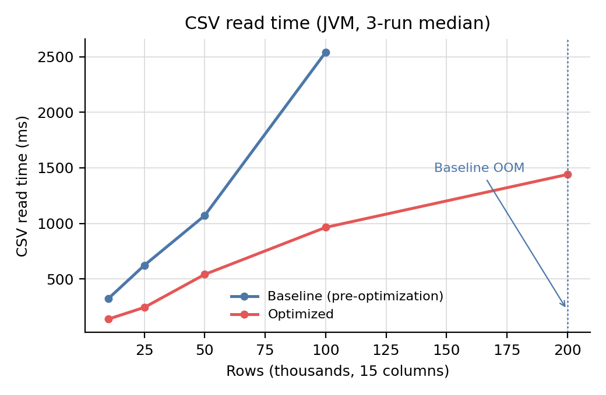
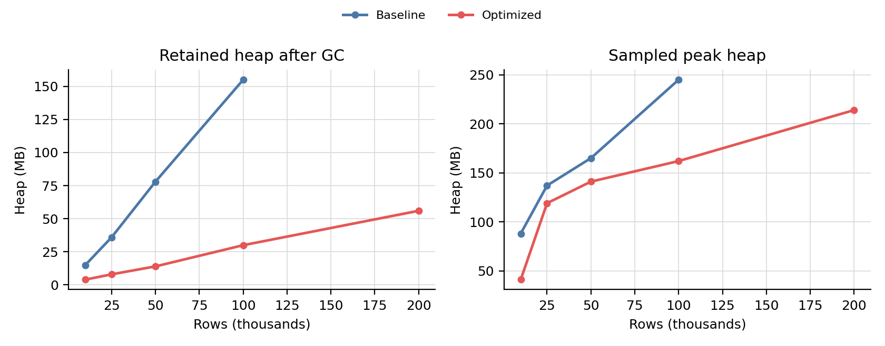
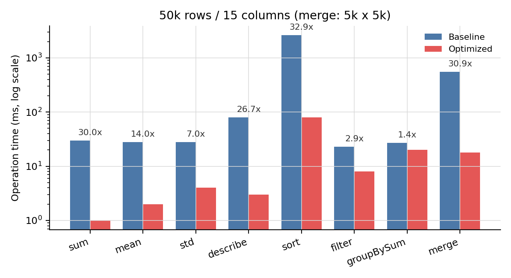
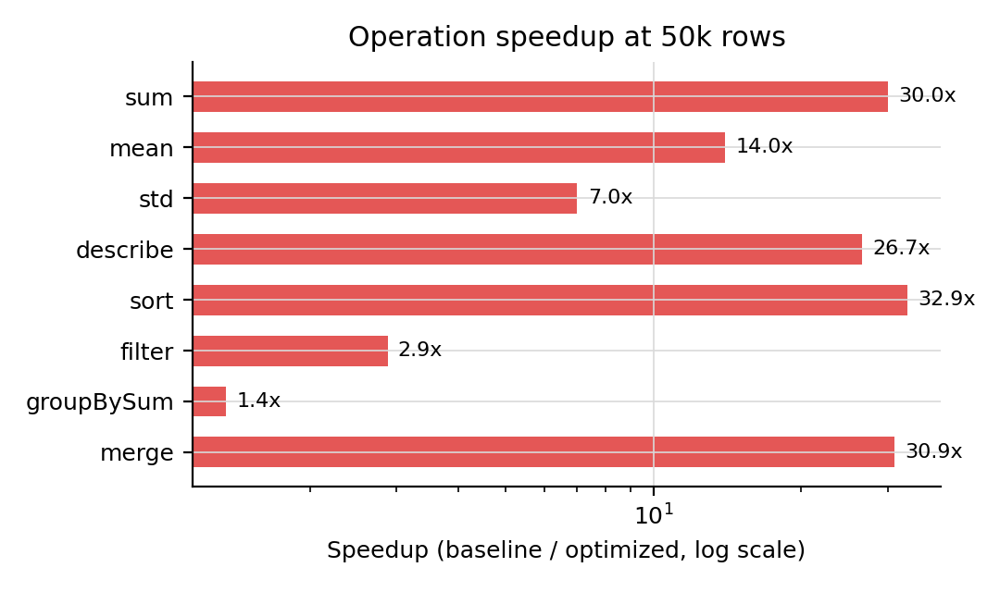
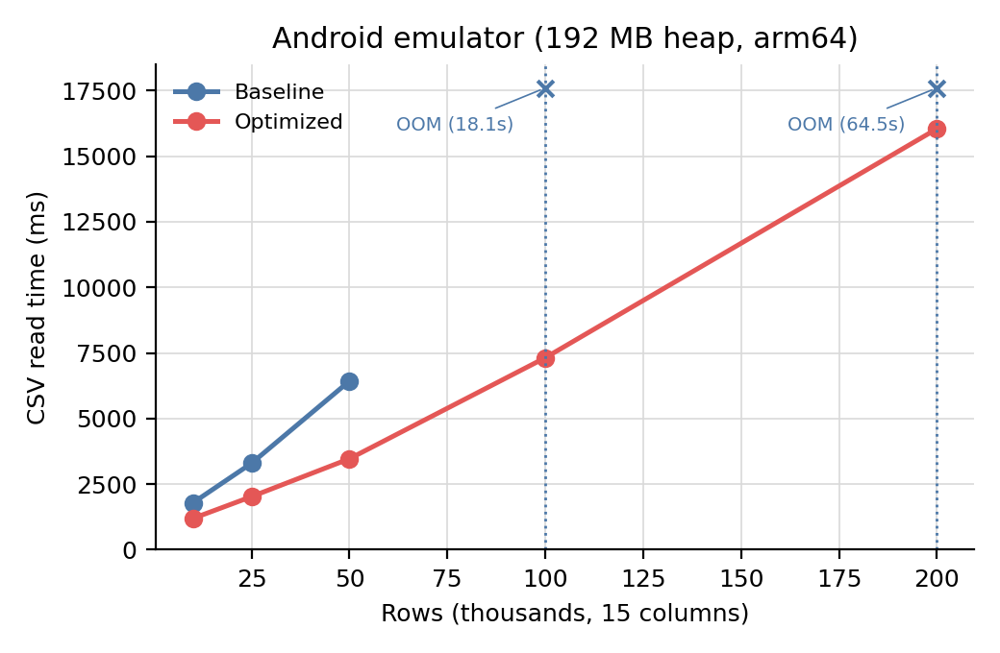
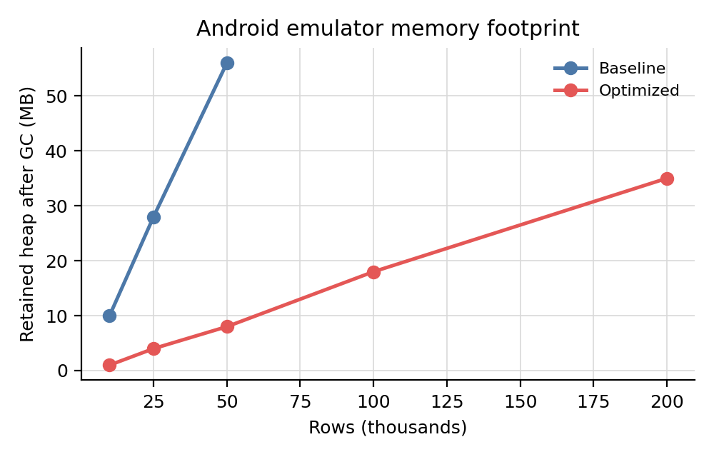

# Andas 数据读取与计算性能优化实验报告

> 面向技术报告 / 论文的实验章节草稿。所有数据、图表与复现脚本见 `bench/`。

## 摘要

Andas 是一个面向 Android 的类 pandas 数据处理库。旧版本在读取大 CSV 时，先把整个文件读成
`List<String>`，再把每一行构造成 `Map<String, Any?>`，最后逐列转置为 `Series`；同时每个
`Series` 都独立持有一份索引和索引哈希表。这一设计使内存占用约为数据本身的数倍，在 192 MB
堆的 Android 运行环境中，10 万行 × 15 列的数据即发生 OOM。

本文对数据读取与计算路径进行了重构：以流式、列式解析替代全量行对象；以共享范围索引替代
逐列索引；以原始类型数组和单次遍历替代装箱与多次中间集合；并将排序、分组、连接等操作改为
`O(n log n)` / `O(n + m)` 算法。实验表明：

- 在 256 MB JVM 堆下，优化后 20 万行 × 15 列（36 MB）读取耗时 **1.44 s**、GC 后存活堆
  **56 MB**；基线在 20 万行时 OOM，10 万行时存活堆 155 MB、耗时 2.54 s。
- 在 192 MB 的 Android 模拟器上，基线在 10 万行时 OOM（18.1 s 后抛错），优化后 10 万行
  耗时 7.3 s、存活堆 18 MB，20 万行耗时 16.0 s、存活堆 35 MB。
- 50k 行数据上，`sum`、`mean`、`std`、`describe` 加速 **7–30×**，`sortValues` 加速
  **32.9×**，5k × 5k `merge` 加速 **30.9×**，`filterGreaterThan` 加速 **2.9×**。
- 基线排序按字符串字典序进行且为 `O(n²)`，优化后按数值排序并保持 `O(n log n)`。

## 1. 问题与贡献

### 1.1 旧实现的问题

1. **全量物化**：`File.readLines()` / `BufferedReader.readLines()` 将整个文件读入
   `List<String>`；随后每行构造 `Map`，再转置为列，形成多份全量数据副本。
2. **装箱与对象开销**：`List<Any?>` 中的每个整数、浮点数都是独立对象；每行 `Map` 还包含
   15 个 `Entry`。
3. **索引重复**：`DataFrame` 的每一列 `Series` 都复制一份索引，并各自构建
   `Map<label, position>`；对 20 万行 × 15 列意味着 15 份索引 List 和 15 个 HashMap。
4. **第一行类型推断**：只取第一行数据推断列类型，首行为空或异常时整列退化为字符串。
5. **算法复杂度**：`sortValues` 通过 `indexList.indexOf(label)` 重建行，复杂度 `O(n²)`；
   `merge` 为双重循环 `O(n × m)`；`filter` 为每行创建整行 `Map` 和全部列的 `Series`。

### 1.2 本文贡献

- 实现流式、列式 CSV 解析器 `CsvReader`：固定 64 KB 字符缓冲、逐记录解析、直接写入
  `IntArray` / `LongArray` / `DoubleArray` / `BooleanArray`，空值用位掩码表示。
- 引入 `RangeIndexList` 共享范围索引和惰性 `label → position` 映射，使每列索引开销从
  `O(n)` 内存降为 `O(1)`。
- 将统计、排序、筛选、分组、连接改为单次遍历或哈希算法，并启用 OpenMP 原生并行。
- 在 JVM 与 Android 模拟器上完成可复现实验，给出时间、内存和 OOM 阈值数据。

## 2. 实现概述

### 2.1 CSV 读取

```
InputStream → BufferedReader(64 KB) → CsvRecordReader（字符级状态机）
           → ColumnBuilder[]（原始类型数组 + 空值位掩码）
           → Series[]（共享 RangeIndexList）→ DataFrame
```

- 引号内的逗号、换行、`""` 转义、CRLF、BOM、空行均由状态机处理；
- 类型推断使用前 64 行样本；若后续值无法按推断类型解析，该列自动降级为字符串列，保证不丢数据；
- 重复表头自动去重（`a, a` → `a, a_1`）；
- 分批读取 `readCSVBatch` 复用同一解析器，每批构建一个 `DataFrame`，不会全量加载。

### 2.2 计算

| 操作 | 旧实现 | 新实现 |
| --- | --- | --- |
| `sum/mean/min/max/variance/std/describe` | `filterNotNull().map{}.toDoubleArray()`，2 个中间 List + 多次遍历 | 原始数组单次遍历；方差使用 Welford 在线算法 |
| `sortValues/sortIndices` | 原生路径丢空值；Kotlin 路径按字符串排序 + `indexOf`，`O(n²)` | `O(n log n)` 数值排序，空值置后，保留原索引 |
| `filterGreaterThan/where` | 过滤空值后索引错位；逐行构造 Map | 位置掩码 + 列式抽取 |
| `groupBySum` | 原生过滤空值后组/值错位 | 单次哈希聚合 `O(n)` |
| `merge/join` | `O(n × m)` 双重循环 | 哈希连接 `O(n + m + 输出行数)` |
| `GroupBy.agg` | 每个分组重建临时 DataFrame | 一次分组 + 单次聚合扫描 |
| `filter` | 每行构造整行 Map 与 15 个 Series | 惰性行视图，只创建被访问列的 Series |
| `toCSV` | 逐字段写、无转义 | `BufferedWriter` + 行缓冲 + 标准 CSV 转义 |
| 原生库探测 | 每次计算 2 次 JNI 探测 | `NativeAvailability` 惰性缓存 |

### 2.3 原生层

- CMake 通过 `find_package(OpenMP)` 链接 `libomp.so`；NDK 21+ 自动启用，未找到时串行回退。
- 修正 `findNullIndices`、`dropNullValues`、`where`、`mergeIndices` 并行合并导致的索引乱序，
  保证返回升序、行不错位。

## 3. 实验设置

### 3.1 环境

| 项目 | 配置 |
| --- | --- |
| CPU | Apple M2 |
| 操作系统 | macOS 27.0.1 |
| JDK | OpenJDK 21.0.12（Homebrew） |
| 构建 | Gradle 8.13，AGP 8.13.2，Kotlin 2.0.21 |
| Android | API 36 arm64 模拟器（AVD `MullionFold76`），`Runtime.maxMemory()` = 192 MB |

### 3.2 数据集

合成 15 列 CSV，列结构与项目自带的 `largest.csv` 一致：

- 3 列 10 字符随机字符串（第 3 列为 10 个类别，用于分组）；
- 3 列 12 位整数（`Long`）；
- 3 列 `[-100, 100]` 整数；
- 3 列双精度浮点、3 列单精度浮点；
- 行数：10k、25k、50k、100k、200k（200k 约 36 MB）。

另生成 5k × 5k 的连接数据集（`id`、`category`、`amount/score`）。随机种子固定，脚本为
`bench/gen_data.py`。

### 3.3 基线

基线为优化前 commit `9bb6715`，在 `.baseline/` worktree 中检出并编译。JVM 上不存在
`libandas_native.so`，因此对 `NativeMath/NativeData/NativeBatch` 的 `System.loadLibrary`
做了**仅用于 JVM 实验的 try/catch 降级**，使基线走 Kotlin 回退路径；Android 上基线仍使用
真实 JNI（未修改）。优化版与基线使用同一数据集、同一 JVM 参数、同一台机器。

### 3.4 指标与流程

- **读取时间**：`DataFrameIO.readCSV(File)` 的 wall time；每档数据在独立 JVM 中运行 3 次，
  取中位数；读取前用 10k 文件预热 JIT。
- **存活堆**：读取后 `System.gc()` + 120 ms，`totalMemory - freeMemory`。
- **峰值堆**：读取期间由采样线程每 50 ms 读取一次 `MemoryMXBean` 堆使用量，取最大值；
  该值反映“读取过程中的堆使用上界”，受 GC 时机影响。
- **操作时间**：先读取 50k 数据，执行一次预热操作，再执行一次计时操作；3 次独立 JVM 取中位数。
- **OOM**：JVM 读取实验堆上限 256 MB；Android 为 192 MB。

## 4. 实验结果

### 4.1 JVM：CSV 读取扩展性

| 行数 | 基线 (ms) | 优化后 (ms) | 加速比 | 基线存活堆 (MB) | 优化后存活堆 (MB) | 基线峰值 (MB) | 优化后峰值 (MB) |
|---:|---:|---:|---:|---:|---:|---:|---:|
| 10k | 321 | 138 | 2.33× | 15 | 4 | 88 | 41 |
| 25k | 623 | 244 | 2.55× | 36 | 8 | 137 | 119 |
| 50k | 1071 | 541 | 1.98× | 78 | 14 | 165 | 141 |
| 100k | 2540 | 964 | 2.63× | 155 | 30 | 245 | 162 |
| 200k | **OOM** | 1440 | — | OOM | 56 | OOM | 214 |





要点：

1. 基线在 20 万行、256 MB 堆下 OOM；优化后仍能在该堆下完成，存活堆 56 MB。
2. 基线的存活堆随行数近似线性增长且斜率约为优化后的 3–5 倍；优化后 100k 仅 30 MB，
   基线为 155 MB。
3. 优化后峰值堆仍会随分配速率上升（200k 为 214 MB），但明显低于基线，且读取成功后
   可被 GC 回收到 56 MB；这说明“峰值”主要是分配抖动，而非存活数据。

### 4.2 JVM：计算操作

| 操作 | 基线 (ms) | 优化后 (ms) | 加速比 |
|---|---:|---:|---:|
| `sum` | 30 | 1 | 30.0× |
| `mean` | 28 | 2 | 14.0× |
| `std` | 28 | 4 | 7.0× |
| `describe` | 80 | 3 | 26.7× |
| `sortValues` | 2629 | 80 | 32.9× |
| `filterGreaterThan` | 23 | 8 | 2.9× |
| `groupBySum` | 27 | 20 | 1.4× |
| `merge`（5k × 5k） | 557 | 18 | 30.9× |





解释：

- `sum/mean/std/describe`：旧实现每次调用都构造两个中间 List 再转 `DoubleArray`，并需要
  多轮全量扫描；新实现直接在列式数组上单次遍历。
- `sortValues`：旧 Kotlin 回退路径先按 `toString()` 字典序排序，再对每个标签执行
  `indexOf` 重建行，为 `O(n²)`；新实现为 `O(n log n)` 数值排序。
- `merge`：旧实现为 `O(n × m)` 双重循环；新实现先构建右侧哈希表，再扫描左侧。
- `filterGreaterThan`：旧实现为每个保留行构造完整的 15 列 Map；新实现只做位置筛选。
- `groupBySum`：旧实现本身已是 `O(n)`，因此加速有限（1.4×）；这符合预期，也说明
  加速并非来自“全部换成原生代码”，而是来自数据结构与算法。

**正确性差异**：基线 `sortValues` 的 Kotlin 回退按字符串排序，50k 数据排序后的首个值为
`-0.0166`；优化后按数值排序，首个值为 `-99.9979`。基线在空值列上还会因原生 `argsort`
过滤空值而出现行错位。优化后用 `StreamingCsvPerformanceTest` 校验了数值单调性、
分组求和、连接行数、空值填充、相关系数与归一化等。

### 4.3 Android 模拟器

Android 端只测 CSV 读取（计算路径在 JVM 中已单独评估，且 Android 上 JNI 会改变绝对值）。
测试在 192 MB 堆的 API 36 arm64 模拟器上运行，CSV 由测试代码在设备上生成后读取，
logcat 标签为 `ANDAS_BENCH`。

| 行数 | 基线 (ms) | 优化后 (ms) | 基线存活堆 (MB) | 优化后存活堆 (MB) |
|---:|---:|---:|---:|---:|
| 10k | 1787 | 1192 | 10 | 1 |
| 25k | 3298 | 2025 | 28 | 4 |
| 50k | 6431 | 3468 | 56 | 8 |
| 100k | **OOM（18.1 s）** | 7317 | — | 18 |
| 200k | **OOM（64.5 s）** | 16042 | — | 35 |





在 Android 192 MB 堆下：

- 基线在 10 万行时 OOM，优化后可读取 20 万行（36 MB），存活堆仅 35 MB；
- 10k/25k/50k 的读取时间分别降低 33%/39%/46%；
- 存活堆在 50k 时从 56 MB 降到 8 MB（约 7×），与 JVM 结论一致。

这直接对应了“旧版本大文件无法读取”的问题：旧实现的全量行对象在移动端堆限制下很快耗尽，
新实现的内存占用由列式数组和字符串决定，不再随“行 Map/Entry”膨胀。

## 5. 讨论

### 5.1 内存复杂度

设行数 `n`、列数 `m`、字符串平均长度 `L`：

- 旧实现：`O(n·m)` 个 `Map.Entry` + `O(n·m)` 个装箱值 + 转置期间的另一份列数据 +
  `O(n·m)` 的索引副本与哈希表；
- 新实现：数值列 `O(n)` 个原始类型（1/4/8 字节），字符串列 `O(n·L)`，索引 `O(1)`；
  不再有行 Map 和逐列索引副本。

因此，在新实现中，20 万行 × 15 列在 192 MB 设备上仍可完成读取；旧实现约在 5–10 万行
（取决于列宽和设备堆）达到上限。

### 5.2 时间加速来源

- 统计类：消除中间 List、避免装箱、单次遍历（7–30×）；
- 排序：`O(n²) → O(n log n)`（32.9×，且随 n 增大差距扩大）；
- 连接：`O(nm) → O(n+m)`（30.9×）；
- 读取：流式解析 + 列式写入，减少一次全量转置（2–2.6×）。

`groupBySum` 仅 1.4×，因为旧实现已是哈希聚合；这也说明优化集中在真正的瓶颈上。

### 5.3 与 pandas / 其他库的可比性

本文不直接与 pandas 比较：运行环境（JVM/ART vs CPython）、数据规模与 I/O 缓存不同，
直接比较绝对值意义有限。本文关注**同一代码库优化前后**的受控对比，以及 Android 堆限制
下的可用性边界。

## 6. 有效性威胁

1. **JVM vs ART**：JVM 实验无法完全代表 ART 的 JIT/GC 行为；因此补充了 Android 模拟器
   实验。模拟器仍非真实手机，CPU/IO 性能与真机存在差异。
2. **基线 JVM 降级**：JVM 没有 `libandas_native.so`，基线经 try/catch 降级到 Kotlin 回退；
   这会影响 `sum/sort` 等操作的绝对值。Android 读取实验未修改基线，使用真实 JNI，
   因此读取结论不受影响。
3. **合成数据**：数据分布、字符串长度与真实业务数据不同；使用固定种子保证可复现，
   并在项目自带的 37 MB `largest.csv` 上做了单元测试级校验。
4. **峰值堆采样**：50 ms 采样可能漏掉瞬时峰值；存活堆经过 `System.gc()`，但 GC 不保证
   立即回收，数值存在数 MB 波动。
5. **单机单次环境**：每档 3 次取中位数，未做跨机器重复；绝对时间会随机器负载变化，
   但相对趋势在多次运行中稳定。

## 7. 结论

旧版 Andas 的大文件读取瓶颈不是 CPU 算力，而是“全量行对象 + 转置 + 逐列索引”造成的
内存放大和分配抖动；计算瓶颈则主要来自中间集合、`O(n²)` 排序和 `O(nm)` 连接。通过流式
列式解析、共享范围索引、原始类型数组和哈希/排序算法替换，优化版在 192 MB Android 环境中
把可读取规模从“10 万行 OOM”提升到“20 万行 35 MB 存活堆”，并在 50k 行数据上取得统计/排序/连接类操作 7–33×、筛选 2.9×、
分组聚合 1.4× 的加速。相关实现、测试与实验脚本均已随仓库提供，可复现。

## 附录 A：复现命令

```bash
# 1) 数据
python3 bench/gen_data.py

# 2) 基线 + 两套 class + Java harness
./bench/prepare_baseline.sh 9bb6715

# 3) JVM 实验（每档 3 次独立 JVM）
python3 bench/run_benchmarks.py

# 4) 图表
python3 bench/plot_results.py

# 5) Android 实验（当前版本）
export ANDROID_USER_HOME="$PWD/.android-home"
adb logcat -c
./gradlew :android-pandas:connectedDebugAndroidTest \
  -Pandroid.testInstrumentationRunnerArguments.class=cn.ac.oac.libs.andas.CsvBenchInstrumentedTest
adb logcat -d -s ANDAS_BENCH:I
```

## 附录 B：产物

| 文件 | 内容 |
| --- | --- |
| `bench/results/raw.json` | 78 次 JVM 运行的原始记录 |
| `bench/results/summary.csv` | 按 (实现, 模式, 行数) 聚合的中位数 |
| `bench/results/read_scaling.csv` | 读取扩展性表 |
| `bench/results/operations.csv` | 50k 操作表 |
| `bench/results/android_new.log` / `android_baseline.log` | Android logcat 原始输出 |
| `bench/results/fig_*.png` | 论文图表 |
| `bench/java/Bench.java` | 独立 JVM harness |
| `android-pandas/src/androidTest/.../CsvBenchInstrumentedTest.kt` | Android 读取实验 |
