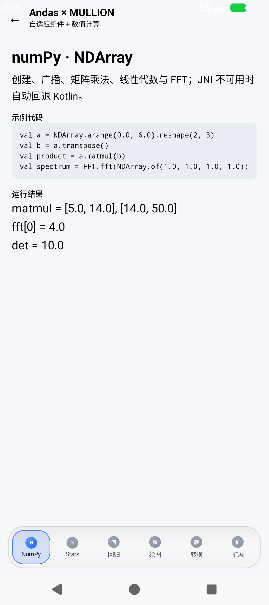

# Demo 应用

仓库包含两个互补的 Demo 入口：

1. **章节式 Demo**：按 SDK 初始化、Series、DataFrame、异步、JNI、性能、批处理逐章运行；
2. **MULLION 功能展廊**：用自适应导航与分栏展示 NDArray、SciPy、绘图、回归、转换与扩展注解。

## 运行

```bash
./gradlew :app:installDebug
adb shell am start -n cn.ac.oac.demo.andas/.MainActivity
```

从首页点击 **“打开 MULLION 自适应功能展廊”**，或直接启动：

```bash
adb shell am start -n cn.ac.oac.demo.andas/.MullionShowcaseActivity
```

## MULLION 功能展廊

展廊使用 [MULLION](https://github.com/Mullion-Official/Mullion-Android-Kotlin-Compose) 的
`MullionTheme`、`MullionWindowProvider`、`AdaptiveScaffold`、`MultiPane` 与 `OrbitNav`：
窄屏使用 BottomBar + 单栏，宽屏自动切换 Rail/Drawer 与 2–3 栏。业务 Screen 中没有
`if (width > 600)`。




展廊包含：

| 模块 | 展示内容 |
| --- | --- |
| NumPy · NDArray | 创建/reshape/广播/matmul、`Linalg.det`、FFT |
| SciPy · Stats | 正态 CDF、t 检验、中位数 |
| SciPy · Regression | 多元线性回归系数、截距与 R² |
| Matplotlib · Figure | 折线 + 散点渲染为 Bitmap |
| pandas ↔ numpy | `DataFrame.toNDArray()`、`toDataFrame()` 与 NaN/null |
| 扩展与注解 | `AndasExtensions` 注册与 `@AndasApi` 系列注解 |

## 设计约定

- 所有计算结果在设备本地实时执行，不依赖网络；
- 绘图使用 `Figure.renderBitmap()`，Compose 通过 `asImageBitmap()` 展示；
- 回归/统计结果直接展示，便于对照文档中的公式；
- Demo 仅用于功能展示，生产环境请按业务规模做性能与内存验证。
